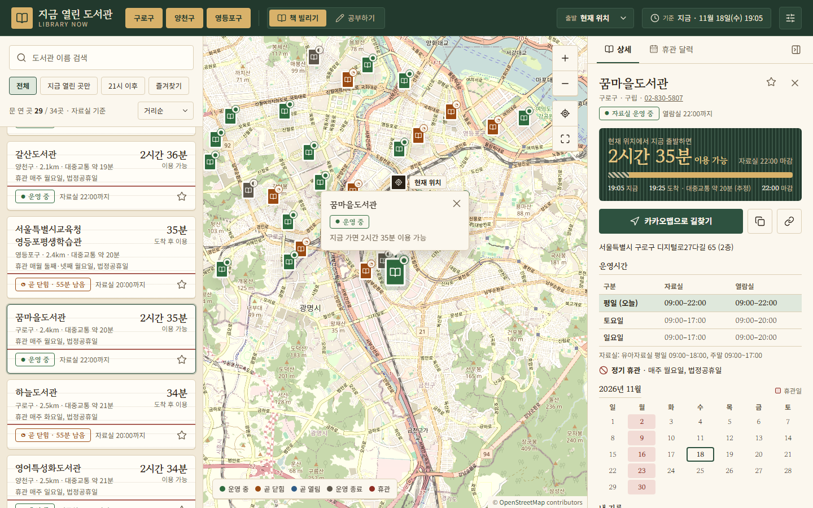
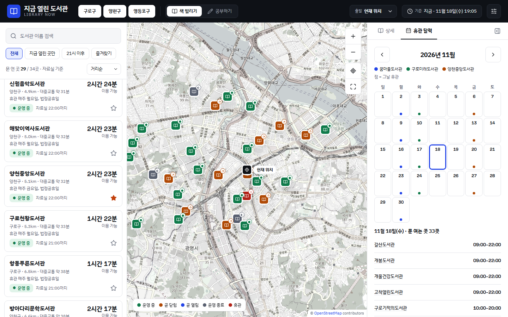

# 지금 열린 도서관 (Library Now)

서울 25개 구 공공도서관 가운데 **지금 문을 연 곳**과 **지금 가면 몇 시간 이용할 수 있는지**를 지도로 보여 주는 반응형 웹앱입니다.

- 구로구·영등포구·양천구 34곳은 도서관 홈페이지와 대조해 자료실·열람실 시간을 따로 넣었습니다.
- 나머지 22개 구 220곳은 공공데이터를 자동 변환한 값이라 **미검수**로 표시합니다. 열람실 시간은 아직 없습니다.

**바로 쓰기:** https://poguni.github.io/library-now/



| 스마트폰 목록 (말랑 테마) | 스마트폰 상세 | 휴관 달력 (모노 테마) |
|---|---|---|
|  |  |  |

## 왜 만들었나
- 휴관일이 도서관마다 다릅니다. "매주 월요일", "매월 둘째·넷째 월요일", "법정공휴일" 같은 규칙이 제각각이라 헛걸음하기 쉽습니다.
- 책을 빌리는 자료실은 18시에 닫아도, 공부하는 열람실은 22시까지 여는 경우가 많습니다.
- 구 경계 근처에 살면 다른 구 도서관이 더 가까울 때가 있습니다.

## 할 수 있는 것
| 기능 | 설명 |
|---|---|
| 운영 상태 | 운영 중 ●, 곧 닫힘 ◔, 곧 열림 ○, 운영 종료 ◐, 휴관 ✕를 색·기호·글자로 함께 표시합니다. |
| 지금 가면 몇 시간 | 현재 위치나 집·직장에서 걸리는 시간을 추정하고, **도착 시각 기준**으로 마감까지 이용 가능한 시간을 계산합니다. |
| 책 빌리기 / 공부하기 | 자료실과 열람실 운영시간을 따로 판단합니다. |
| 지역·목록·필터 | 25개 구 중 원하는 구만 고르고, 지금 열린 곳만·21시 이후·즐겨찾기·검수된 곳만으로 거르고, 거리순·남은 시간순·이름순으로 정렬합니다. 지도에서는 가까운 도서관을 묶어 보여 줍니다. |
| 링크 공유 | 상세 화면에서 도서관과 이용 모드가 담긴 링크를 복사하거나 공유합니다. 위치는 담지 않습니다. |
| 길찾기 | 카카오맵으로 바로 연결합니다. 스마트폰에서는 네이버 지도도 쓸 수 있습니다. |
| 상세·휴관 달력 | 운영시간 표, 정기 휴관 규칙, 이번 달 휴관일, 즐겨찾기 도서관의 휴관일을 겹쳐 본 달력을 보여 줍니다. |
| 기준 시각 바꾸기 | "토요일 오후 3시에 출발하면?"처럼 날짜와 시각을 골라 다시 계산합니다. |
| 내 기록 | 도서관별 메모와 공사·행사로 인한 임시 휴관을 직접 넣으면 계산에 반영합니다. JSON 파일로 내보내고 가져올 수 있습니다. |
| 화면 테마 | 서재(기본)·말랑·모노 세 가지입니다. |
| 홈 화면 설치 | 스마트폰 홈 화면에 앱처럼 설치할 수 있고, 오프라인에서도 목록·운영시간·달력을 볼 수 있습니다. 지도 배경은 연결되어 있을 때만 보입니다. |

### 홈 화면에 설치하기
- **안드로이드(Chrome·삼성 인터넷):** 메뉴 → "홈 화면에 추가" 또는 "앱 설치"
- **아이폰(Safari):** 공유 버튼 → "홈 화면에 추가"

## 계산 방식
- 모든 시간은 기기 시간대와 관계없이 **서울 시각(Asia/Seoul)** 기준입니다.
- 하루 운영 판정 순서: 임시 휴관 → 정기 휴관(매주·매월 n째 요일) → 공휴일 → 요일·계절별 운영시간.
- 이동 시간은 **추정값**입니다. 직선거리에 1.3을 곱한 뒤, 1.5km 이하는 도보(시속 4.2km), 그보다 멀면 대중교통(10분 + 시속 18km)으로 계산합니다. 정확한 경로는 길찾기 버튼으로 확인해 주세요.
- 확인하지 못한 운영시간은 지어내지 않고 "운영시간 확인 필요"로 표시합니다.
- 자동 변환한 도서관은 휴관일 원문을 상세 화면에 함께 보여 줍니다. 변환 결과와 확인할 점은 `data/auto-review.md`에 정리됩니다.

## 개인정보
- 로그인, 서버, DB가 없습니다. 설정·즐겨찾기·출발지·메모는 **이 브라우저(localStorage)에만** 저장합니다.
- 위치와 출발지 좌표는 밖으로 보내지 않습니다. 예외는 길찾기 링크를 누를 때 지도 앱에 넘기는 좌표뿐입니다.

## 데이터 출처
| 데이터 | 제공 | 용도 |
|---|---|---|
| 전국도서관표준데이터 | 공공데이터포털 | 도서관 이름·주소·좌표·휴관일 |
| 서울시 공공도서관 현황정보 | 서울 열린데이터광장 | 교차 확인 |
| 각 도서관 홈페이지 이용 안내 | 구립·교육청 도서관 | 자료실·열람실 운영시간 |
| 공휴일 | 정부 발표를 직접 정리 (2026·2027년) | 공휴일 휴관 판정 |
| 배경 지도 | © OpenStreetMap contributors (ODbL) | 지도 타일 |

- 데이터 기준일과 출처는 앱의 **설정 → 데이터 정보**에서도 볼 수 있습니다.
- 공공데이터의 이용 조건(공공누리 유형)은 아직 확인 중이며, 확인되면 이곳과 `meta.json`에 적습니다.
- 운영시간과 휴관 규칙은 바뀔 수 있습니다. 임시 휴관은 도서관 홈페이지 공지를 함께 확인해 주세요.
- 지도 타일은 OSM 타일 이용 정책에 따라 출처를 표기하고, 미리 내려받거나 저장(오프라인 캐시)하지 않습니다.

## 기술 스택
- Vite + React + TypeScript (strict)
- Leaflet + OpenStreetMap 타일, leaflet.markercluster(마커 묶기). 지도 코드는 `src/map/`의 `MapProvider` 인터페이스 뒤에 있습니다
- CSS Modules + CSS 변수(디자인 토큰), lucide-react 아이콘
- vite-plugin-pwa (홈 화면 설치, 앱·데이터 오프라인 저장)
- Vitest(시간 계산·휴관 판정 단위 테스트), Playwright(1440×900·390×844 × 테마 3종 화면 테스트)
- GitHub Actions → GitHub Pages 배포

## 개발
```bash
npm install
npm run dev          # http://localhost:5173/library-now/
npm run build        # 타입 검사 + 프로덕션 빌드
npm run test         # 단위 테스트
npm run test:e2e     # 화면 테스트 (처음 한 번 npx playwright install chromium)
npm run lint         # ESLint + Prettier 검사
npm run data:build   # data/ → public/data/*.json (검증 실패 시 중단)
```

```
src/domain/   시간 계산·휴관 판정·거리 계산 (순수 함수 + 테스트)
src/map/      MapProvider 인터페이스와 Leaflet 구현
src/components/ 화면 컴포넌트
src/state/    설정·즐겨찾기·출발지·메모 저장 (localStorage)
data/         공공데이터 원본, 수기 입력값, 공휴일
scripts/      데이터 빌드 스크립트
docs/         기획서(PRD)와 README 스크린샷
design/       디자인 가이드와 시안
```

## 앞으로
- 자동 변환한 22개 구 도서관을 홈페이지와 대조해 검수하기
- 카카오맵 지도 선택
- "이 책이 있는 문 연 도서관" 찾기 (도서관 정보나루 연동 검토)
